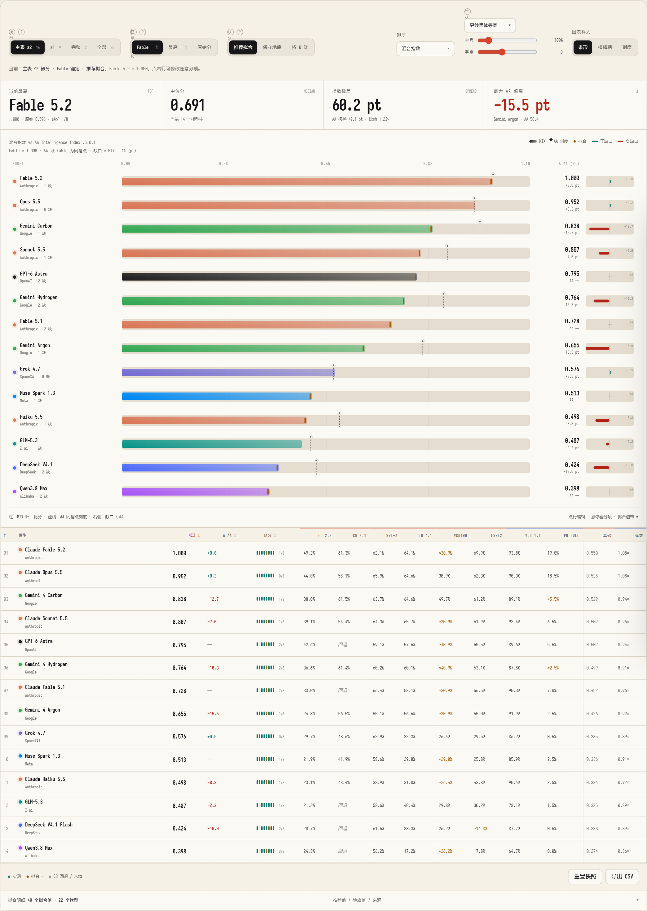

# 21BenchMixIndex

**Coding Model Mixture Index** — a reproducible, modifiable decision tool that compresses public data from AA Coding Agent, AA Intelligence, VALS, CursorBench, FrontierSWE and ProgramBench into a single coding-model index.

This is an index, not a leaderboard.

[中文](README.md)

## Current index (data version 26/11/20)

> Rendered locally; open the HTML to interact (filtering, normalisation, imputation policy, per-metric editing, CSV export).

## Open it

- Open `21BenchMixIndex261120.html` directly: single file, zero external dependencies, fonts from the local font stack (Sarasa Mono / 更纱黑体 by default).
- GitHub Pages: set the repo root as the Pages source; `index.html` redirects to the entry page named by data version.
- Data version: see `meta[name="release-date"]` in the HTML (YY/MM/DD). When updating data, change only this value, rename the entry file to match, and update the `index.html` redirect target plus the README screenshot.

## What's inside

- Bilingual UI: one-click `EN / 中` toggle in the header; the choice persists locally.
- The main board shows only models with **≤2 missing** of the 8 raw inputs; switch to "All" for the reference pool.
- Missing data: a missing CB triggers the formula fallback; missing PB / VCB100 / FSWE follow "Recommended / Floor / Zero" imputation, and every value can be hand-edited in the drawer.
- Normalisation: `Fable 5.2 = 1` / `Max = 1` / `Raw`.
- AA cross-check: same-anchor scale and gap against **AA Intelligence Index v5.0.1**.
- Actual distribution: MIN / P25 / MEDIAN / P75 / MAX + dot histogram, no preset tiers.
- Light & dark themes; lab brand colours on bars; chart style switcher (bars / lollipop / tick).
- Display options: pick a font from the local font stack (Chromium can also detect installed fonts), and drag sliders for text size (90%–160%) and weight (−200 to +300); choices persist locally.
- CSV export, add custom models, fit details, copy citation.

## Data sources

- [AA Coding Agent Index v2.1](https://artificialanalysis.ai/agents/coding-agents)
- [AA Intelligence Index v5.0.1](https://artificialanalysis.ai/leaderboards/models)
- [VALS VCB 1-100 v1.1](https://www.vals.ai/benchmarks/vcb-1-100-v1-1)
- [VALS Vibe Code Bench v1.1](https://www.vals.ai/benchmarks/vibe-code)
- [VALS ProgramBench](https://www.vals.ai/benchmarks/programbench)
- [CursorBench 4.1](https://cursor.com/cursorbench)
- [FrontierSWE v2](https://www.frontierswe.com/)
- [Terminal-Bench 4.1](https://www.tbench.ai/)

Underlying benchmark data and trademarks belong to their respective publishers; this repo only aggregates and visualises.

## License

This work is licensed under [CC BY-NC-SA 4.0](https://creativecommons.org/licenses/by-nc-sa/4.0/). Attribution, non-commercial, share alike. For commercial licensing, contact the author.

## Feedback

- GitHub Issue / PR
- Bilibili: <https://space.bilibili.com/334394212>
- GitHub: <https://github.com/2youg1>

Renders well in the author's LibreWolf; 100% compatibility across every configuration is not guaranteed.
