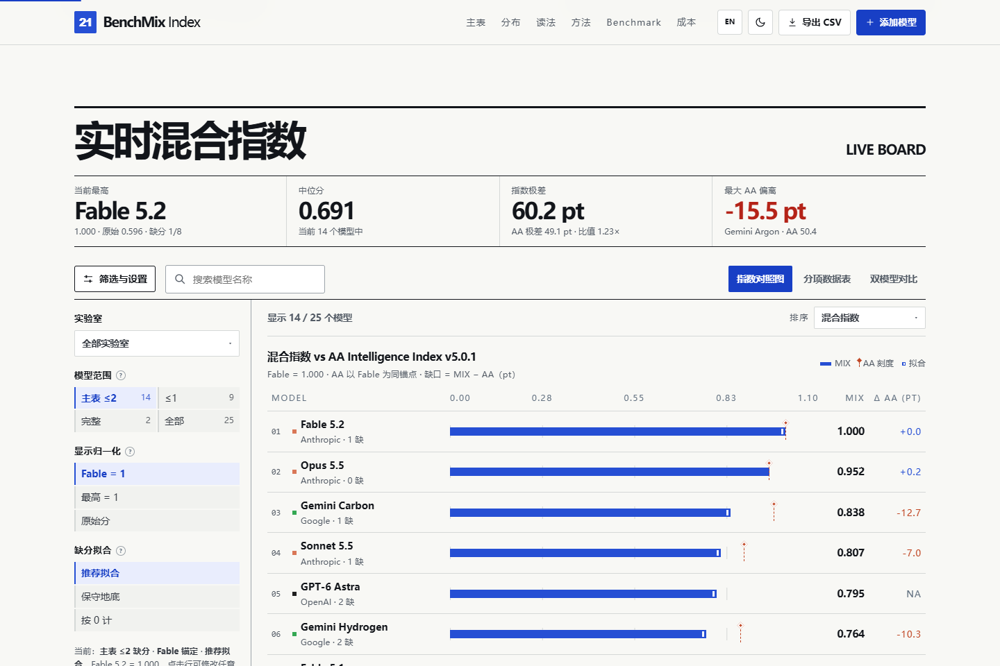

# 21BenchMixIndex

编码模型混合指数（Coding Model Mixture Index）。把 AA Coding Agent、AA Intelligence、VALS、CursorBench、FrontierSWE、ProgramBench 的公开数据压成一个可复算、可修改的编码模型决策工具。

这是一个指数，不是榜单。

[English](README.en.md)

## 当前指数（数据版本 26/11/20）

[查看分布区间探索截图](docs/distribution.png)

> 截图为本机渲染效果；打开 HTML 可交互（筛选、归一化、拟合策略、逐项编辑、CSV 导出）。

## 打开

- 直接打开 `21BenchMixIndex261120.html`：单文件、零外部依赖，字体使用本机字体栈（默认系统无衬线，可选更纱黑体等宽）。
- GitHub Pages：把仓库根目录设为 Pages 源，`index.html` 会自动跳转到按数据版本命名的入口页。
- 数据版本：见 HTML 的 `meta[name="release-date"]`（YY/MM/DD）。更新数据时只改这一处，并按新日期重命名入口文件、`index.html` 的跳转目标与 README 截图。

## 页面内容

- 中英双语界面：页眉 `EN / 中` 一键切换，选择记在本机。
- 按模型名搜索或按实验室筛选。桌面筛选栏可收起，手机默认收起。指数对照图和分项数据表共享筛选与排序；在表格中点击数值可编辑百分比，点击模型可查看得分拆解。
- 双模型对比可在当前范围内任选两个模型，并排查看 MIX 和八项百分数。拟合值带 ≈，缺测或公式回退显示为破折号。
- 「调整计分系数」支持滑块和精确输入。默认使用原版六项 BASE 权重和两项乘数系数。缺 CB 时，其权重按 2∶1∶1 转给 FC、TB、FSWE。当前浏览器会保存个人系数、改分、自定义模型和可选的试算日期，CSV 带有计算配置。
- Benchmark 指南逐项说明任务、评测方式、开放程度和公式中的用途，并提供来源链接。点击数据表的指标表头可跳到对应说明。
- 主表默认只显示原始 8 项中 **≤2 项缺分** 的模型；可切到“全部”查看参考池。
- 缺分处理：CB 缺失走公式回退；PB / VCB100 / FSWE 缺失按“推荐拟合 / 保守地底 / 按 0 计”处理，也可在抽屉里逐项手填。
- 归一化：`Fable 5.2 = 1` / `最高分 = 1` / `原始分`。
- AA 对照：与 **AA Intelligence Index v5.0.1** 做同锚点刻度与缺口比较。
- 实际分布：支持 MIX 和 Δ AA，可查看全体候选或跟随主表。选中直方图区间即可查看成员并打开模型详情，同时展示五个分位统计。
- 明暗双主题；钴蓝标记 MIX，朱橙标记 AA，模型名旁保留实验室品牌色；图表样式可切“条形 / 棒棒糖 / 刻度”。
- 显示可调：字体在本机字体栈中选择（Chromium 还可一键检测已安装字体），字号（90%–160%）与字重（−200 ~ +300）用滑块调节，选择记在本机。
- 支持 CSV 导出、添加自定义模型、拟合明细、复制引用。

## 数据来源

- [AA Coding Agent Index v2.1](https://artificialanalysis.ai/agents/coding-agents)
- [AA Intelligence Index v5.0.1](https://artificialanalysis.ai/leaderboards/models)
- [VALS VCB 1-100 v1.1](https://www.vals.ai/benchmarks/vcb-1-100-v1-1)
- [VALS Vibe Code Bench v1.1](https://www.vals.ai/benchmarks/vibe-code)
- [VALS ProgramBench](https://www.vals.ai/benchmarks/programbench)
- [CursorBench 4.1](https://cursor.com/cursorbench)
- [FrontierSWE v2](https://www.frontierswe.com/)
- [Terminal-Bench 4.1](https://www.tbench.ai/)

底层 benchmark 数据与商标归各发布方所有；本仓库只做聚合与可视化。

## 许可

本作品采用 [CC BY-NC-SA 4.0](https://creativecommons.org/licenses/by-nc-sa/4.0/) 国际许可协议。署名、非商业、相同方式共享。商用授权请联系作者。

## 反馈

- GitHub Issue / PR
- Bilibili：<https://space.bilibili.com/334394212>
- GitHub：<https://github.com/2youg1>

显示效果在作者本机的 LibreWolf 浏览器上表现不错；不保证 100% 全配置兼容。
